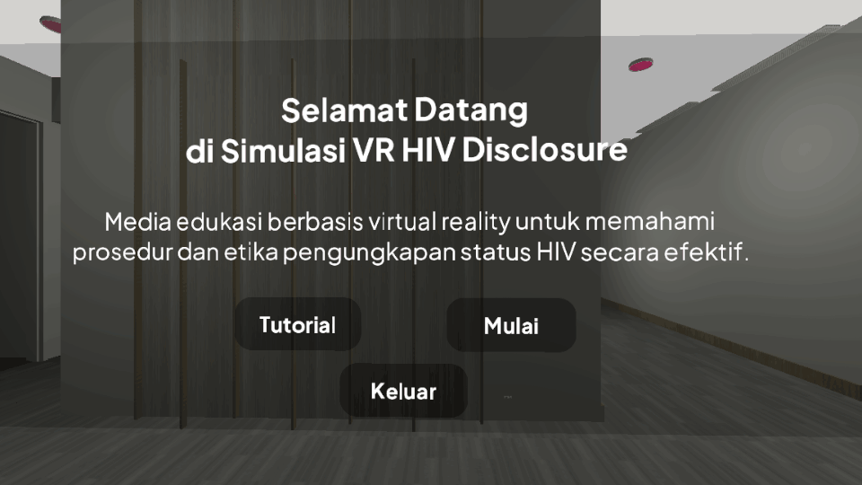
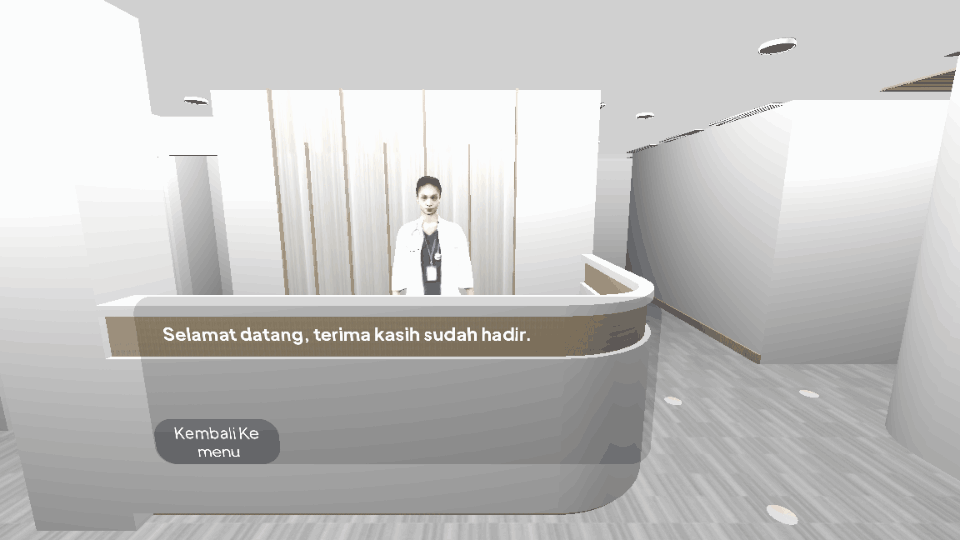
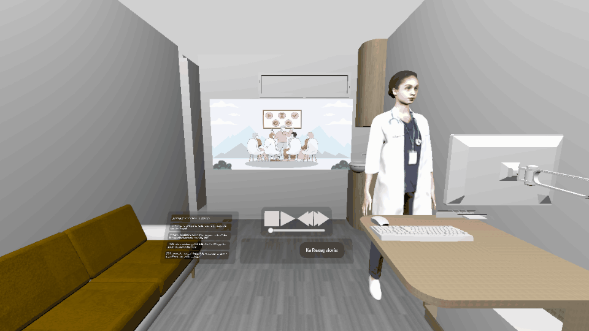
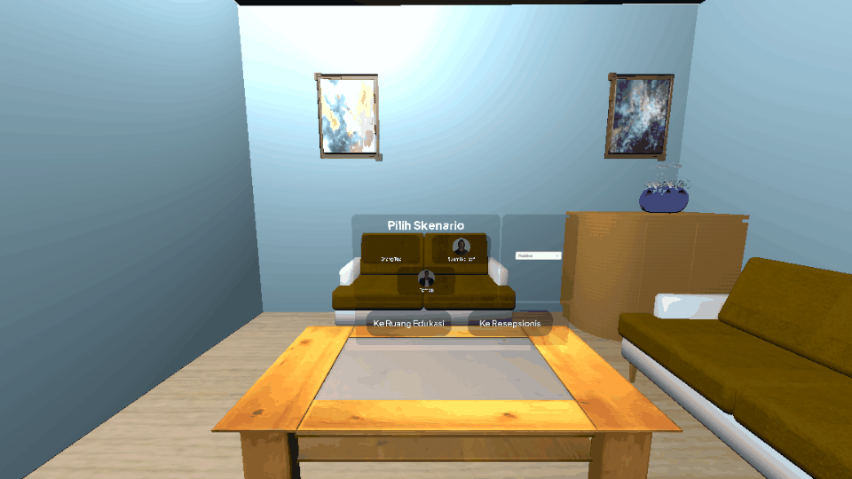

<div align="center">

# VR HIV Disclosure

**Belajar memahami keterbukaan status HIV dan berlatih berkomunikasi melalui pengalaman virtual reality.**


[Tentang aplikasi](#tentang-aplikasi) · [Cuplikan aplikasi](#cuplikan-aplikasi) · [Spesifikasi](#spesifikasi) · [Tech stack](#tech-stack) · [Menjalankan project](#menjalankan-project) · [Dokumentasi kode](#dokumentasi-kode)

</div>

## Tentang aplikasi

**VR HIV Disclosure** adalah aplikasi edukasi dan simulasi berbasis virtual reality untuk membantu pengguna memahami pengungkapan status HIV (*HIV disclosure*) serta berlatih menyampaikannya kepada orang terdekat. Pengguna menjelajahi lingkungan klinik virtual, mengikuti penjelasan tenaga kesehatan, dan mencoba percakapan dengan karakter dalam berbagai situasi.

Pengalaman aplikasi terdiri dari empat bagian: **menu utama, resepsionis, ruang edukasi, dan ruang simulasi**. Materi, dialog teks, voice-over, dan animasi karakter mendukung proses belajar serta latihan komunikasi di dalam lingkungan virtual.

### Fitur utama

- **Menu dan tutorial VR** untuk memulai pengalaman serta mengenali interaksi aplikasi.
- **Pilihan avatar pemain dan tenaga kesehatan** yang digunakan sepanjang alur aplikasi.
- **Resepsionis virtual** dengan dialog pengantar dan akses menuju ruangan berikutnya.
- **Ruang edukasi** dengan video, kontrol pemutaran, dan pertanyaan tentang pengungkapan status HIV.
- **Ruang simulasi** untuk berlatih disclosure kepada pasangan, orang tua, atau teman.
- **Variasi reaksi karakter** dalam kategori positif, netral, negatif, serta pemilihan acak.
- **Dialog audiovisual** dengan teks bertahap, voice-over, ekspresi, dan animasi karakter.
- **Perpindahan berbasis teleport** antartitik dalam lingkungan klinik.

## Cuplikan aplikasi

GIF berikut menampilkan preview visual dari scene Unity project ini. Cuplikan disusun untuk dokumentasi fitur dan bukan rekaman penggunaan di headset.

### 1. Menu utama



Halaman awal untuk membuka tutorial, memulai aplikasi, dan memilih pengaturan avatar sebelum masuk ke klinik virtual.

### 2. Resepsionis



Pengguna disambut oleh tenaga kesehatan virtual dan diarahkan menuju ruang edukasi atau ruang simulasi.

### 3. Ruang edukasi



Pengguna mempelajari HIV disclosure melalui materi video dan pilihan pertanyaan yang dijawab oleh tenaga kesehatan virtual.

### 4. Ruang simulasi



Pengguna memilih lawan bicara, mencoba menyampaikan status HIV, dan mengamati variasi respons karakter dalam skenario percakapan.

## Spesifikasi

| Komponen | Spesifikasi project |
| --- | --- |
| Perangkat sasaran | **Meta Quest 2 dan Meta Quest 3** |
| Mode penggunaan | VR standalone pada headset |
| Platform build | Android |
| Arsitektur | ARM64 |
| Scripting backend | IL2CPP |
| Interaksi | Controller, ray interaction pada UI, dan teleportasi |
| Bahasa konten | Bahasa Indonesia |
| Android Minimum API | API 32, sesuai konfigurasi project saat ini |
| Android Target API | API 32, sesuai konfigurasi project saat ini |

Quest 2 dan Quest 3 diaktifkan pada konfigurasi Meta Quest Support di `XR/Settings/OpenXR Package Settings.asset`. Tabel ini mencatat target dan konfigurasi project; GIF di atas tidak menjadi bukti pengujian performa pada perangkat fisik.

## Tech stack

| Teknologi | Versi | Penggunaan |
| --- | --- | --- |
| **Unity 6** | **6000.0.39f1** | Engine dan editor project |
| **C#** | Mengikuti toolchain Unity | Logika aplikasi, UI, dan pengelolaan dialog |
| **Meta XR All-in-One SDK** | **81.0.0** | Integrasi perangkat dan fitur Meta XR |
| Meta XR Core SDK | 81.0.0 | Camera rig dan komponen inti XR |
| Meta XR Interaction SDK | 81.0.0 | Interaksi controller, UI, dan locomotion |
| OpenXR Plugin | 1.14.3 | Runtime XR dan dukungan Meta Quest |
| XR Plug-in Management | 4.5.3 | Konfigurasi loader XR |
| Universal Render Pipeline | 17.0.3 | Rendering scene |
| Input System | 1.13.0 | Pengelolaan input |
| Timeline | 1.8.12 | Urutan animasi dan pemutaran karakter |
| Unity UI / TextMeshPro | Unity UI 2.0.0 | Panel world space, pilihan, dan teks dialog |
| Unity VideoPlayer | Modul bawaan Unity | Pemutaran video edukasi |
| UnityMeshSimplifier | Dependensi Git | Penyederhanaan mesh |
| Unity UI Rounded Corners | Dependensi Git | Tampilan panel UI bersudut membulat |

Versi engine diambil dari `ProjectVersion.txt`; versi paket mengikuti snapshot `manifest.json` dan `packages-lock.json` dalam [konfigurasi project](Documentation~/project-setup/).

## Alur penggunaan

1. Buka aplikasi dan pelajari tutorial interaksi pada menu utama.
2. Mulai pengalaman, lalu pilih avatar pemain dan tenaga kesehatan.
3. Ikuti pengantar di resepsionis virtual.
4. Kunjungi ruang edukasi untuk melihat video dan mengeksplorasi pertanyaan tentang HIV disclosure.
5. Masuk ke ruang simulasi, lalu pilih percakapan dengan pasangan, orang tua, atau teman.
6. Pilih kategori respons atau mode acak, lalu ikuti rangkaian disclosure, reaksi karakter, dan tanggapan lanjutan.
7. Ulangi skenario untuk mengeksplorasi variasi percakapan atau kembali ke menu.

## Menjalankan project

### Kebutuhan pengembangan

- Unity Hub dan **Unity Editor 6000.0.39f1**.
- Modul **Android Build Support**, termasuk Android SDK & NDK Tools dan OpenJDK melalui Unity Hub.
- Git untuk mengambil repositori dan dependensi paket berbasis Git.
- Meta Quest 2 atau Meta Quest 3 beserta controller untuk mencoba pengalaman VR pada perangkat.

### Struktur repo dan konfigurasi Unity

Root repositori ini adalah **isi folder `Assets`**, sehingga `Scenes`, `Script`, dan folder aset lain terlihat langsung di halaman GitHub. Folder `Packages` dan `ProjectSettings` asli berada satu tingkat di atas root repo.

Snapshot konfigurasi yang diperlukan untuk menyusun ulang project tersedia di [`Documentation~/project-setup/`](Documentation~/project-setup/). Folder dokumentasi berakhiran `~` agar isinya tidak diimpor Unity sebagai aset aplikasi.

### Setup dari hasil clone

Contoh berikut menggunakan PowerShell. Ganti `URL_REPOSITORY` dengan URL clone repo ini.

```powershell
git clone URL_REPOSITORY vr-hiv-disclosure/Assets

Copy-Item -Path "vr-hiv-disclosure/Assets/Documentation~/project-setup/Packages" -Destination "vr-hiv-disclosure" -Recurse
Copy-Item -Path "vr-hiv-disclosure/Assets/Documentation~/project-setup/ProjectSettings" -Destination "vr-hiv-disclosure" -Recurse
```

Struktur project setelah setup:

```text
vr-hiv-disclosure/
├── Assets/                 # Root Git repo ini
├── Packages/               # Manifest dan lock paket
└── ProjectSettings/        # Konfigurasi Unity dan versi editor
```

1. Tambahkan folder **`vr-hiv-disclosure`** melalui Unity Hub, lalu buka dengan Unity **6000.0.39f1**.
2. Tunggu Package Manager menyelesaikan pemulihan dependensi dan proses impor aset.
3. Buka `Assets/Scenes/MenuScene.unity` sebagai titik awal agar pilihan avatar dan manajer lintas scene terinisialisasi.
4. Untuk build Android, buka **File → Build Profiles** dan gunakan profil **VR Standalone** di `Assets/Settings/Build Profiles/`.
5. Pastikan `MenuScene` dan `MainGameScene` aktif pada daftar scene build. Profil **VR Standalone** menyertakan keduanya; daftar global project saat snapshot hanya mengaktifkan `MenuScene`.
6. Periksa OpenXR pada **XR Plug-in Management** serta Meta Quest Support untuk target Android, lalu jalankan validasi project XR yang tersedia di editor.
7. Buat build APK dan jalankan pada Quest untuk memeriksa interaksi, audio, kenyamanan tampilan, dan alur perpindahan ruangan.

Preview di Unity Editor membantu memeriksa scene dan UI. Interaksi VR lengkap perlu dijalankan melalui perangkat XR atau setup simulator yang sesuai.

## Struktur kode

```text
.
├── Scenes/
│   ├── MenuScene.unity
│   ├── MainGameScene.unity
│   └── MenuScene_Standalone.unity
├── Script/
│   ├── DialogueScripts/
│   │   ├── DialogueController.cs
│   │   ├── DialogueManager.cs
│   │   ├── DialogueSequence.cs
│   │   ├── DialogueTrigger.cs
│   │   └── ReceptionistSceneDialogue.cs
│   ├── GameData.cs
│   ├── GenderController.cs
│   ├── EduRoom.cs
│   ├── SimulationRoomScript.cs
│   ├── ManualTele.cs
│   ├── VRSpawner.cs
│   └── ...
├── Audio/
├── Video/
├── UI Sprite/
├── XR/
├── Settings/
└── Documentation~/
    ├── media/
    └── project-setup/
```

## Dokumentasi kode

Seluruh **23 file C#** dalam [`Script/`](Script/), termasuk [`DialogueScripts/`](Script/DialogueScripts/), memiliki komentar berbahasa Indonesia. Komentar menjelaskan peran komponen, referensi Inspector, metode yang dipanggil UnityEvent, serta alur yang memerlukan konteks tambahan.

| Kelompok | Script | Tanggung jawab |
| --- | --- | --- |
| Data dan scene | `GameData`, `GameManager`, `SceneManagementScript` | Pilihan avatar lintas scene, akses teleport, dan perpindahan scene |
| Menu | `UIMenuController`, `TutorialMenu`, `GenderController` | Panel menu, halaman tutorial, dan pilihan avatar |
| Edukasi | `EduRoom`, `VideoPlayerScript` | FAQ berdasarkan tenaga kesehatan dan kontrol video |
| Simulasi | `SimulationRoomScript` | Pemilihan lawan bicara serta urutan disclosure, reaksi, dan tanggapan |
| Dialog | `DialogueController`, `DialogueManager`, `DialogueSequence`, `DialogueTrigger`, `ReceptionistSceneDialogue` | Registri dialog, data teks/audio, pemutaran, dan pengantar resepsionis |
| Perpindahan | `ManualTele`, `VRSpawner`, `ButtonScript` | Penempatan awal serta perpindahan antarposisi |
| Audio dan animasi | `SoundManager`, `AnimPlayer`, `AnimStateController`, `TimelineLoopRange` | Voice-over, ekspresi, status berbicara, dan rentang loop Timeline |
| Rendering | `FoveatedRenderingStarter`, `SimplifyMesh` | Pengaturan foveasi dan penyederhanaan mesh |

### Menambah atau menyesuaikan dialog

1. Atur sebuah `DialogueSequence` pada komponen `DialogueTrigger` di scene.
2. Gunakan `dialogueName` unik yang cocok persis dengan nama yang dipanggil script ruangan.
3. Isi target `textBox`, `audioSource`, serta pasangan `dialogueLines` dan `dialogueAudio`. Setiap baris memerlukan pasangan klip audio karena keduanya diambil dari antrean secara bersamaan.
4. Hubungkan `preDialogueAction` dan `postDialogueAction` untuk mengatur animasi, panel, atau kelanjutan alur.
5. Pastikan pemicu berada pada GameObject registri atau child yang aktif saat `DialogueController.Awake()` mengumpulkan daftar dialog.

Pada teks dialog, karakter `|` memberi jeda tanpa ditampilkan. Karakter baris baru memberi jeda dan mengganti teks yang tampil. Penyelesaian dialog secara manual melalui `EndDialogue()` juga memanggil event akhir.

## Kontribusi

Perubahan pada scene, UI, dan dialog perlu mempertahankan referensi Inspector serta file `.meta` Unity. Saat mengubah naskah, periksa kesesuaian teks, voice-over, nama dialog, dan event animasinya. Sertakan penjelasan perubahan serta hasil pemeriksaan pada pull request.

## Lisensi

Repositori ini belum menetapkan lisensi kode aplikasi. Paket, model, audio, video, dan aset pihak ketiga mengikuti ketentuan lisensinya masing-masing.
